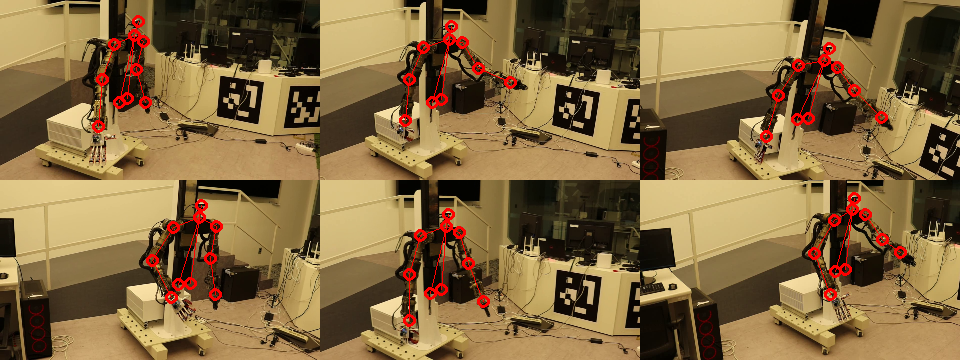
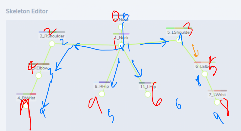

# Humanoid Upper-Body Skeleton Annotation Check

Skeleton keypoint annotation work and a Python check of the exported JSON, done at the XR Lab in December 2022.

## Overview

- Annotated approximately 5,000 frames of humanoid upper-body skeleton keypoint data (10 joints per frame)
- Analyzed the structure of the exported annotation JSON
- Parsed the keypoint coordinates with Python and drew them back onto the original video frames with OpenCV, to visually check that every label sits on the correct joint

## Sample Results

Keypoints from `Left_dynamic.json` drawn on the original frames. Red circles are joints and red lines are bones.

## Dataset

Recorded from 3 camera views, each with 3 scenarios, for 9 JSON files in total.

| View | Scenarios |
|---|---|
| Center | dynamic, fix_1, fix_2 |
| Left | dynamic, fix_1, fix_2 |
| Right | dynamic, fix_1, fix_2 |

Each annotated frame has 10 skeleton nodes.

`0_Nose`, `1_Neck`, `2_RShoulder`, `3_RElbow`, `4_RWrist`, `5_LShoulder`, `6_LElbow`, `7_LWrist`, `8_RHip`, `11_LHip`

The raw JSON files and full video frames are not included in this repository. Only the sample results below are included. The Google Drive file IDs in the notebook are replaced with placeholders such as `FILE_ID_CENTER_DYNAMIC`.

## JSON Structure

See [docs/json-structure.md](docs/json-structure.md).

## How the Check Works

The notebook in [notebook/skeleton_overlay.ipynb](notebook/skeleton_overlay.ipynb) runs on Google Colab.

1. Download the 9 JSON files
2. Select one file and load it
3. Read the frame image URLs from `item.slots[0].frame_urls`
4. For each annotation, read the frame number and the `x`, `y` of every node from `frames.<frame>.skeleton.nodes`
5. Download the matching frame image and resize it from 1280x720 to 320x180 (coordinates are divided by 4)
6. Draw each joint with `cv2.circle()` and connect the joints with `cv2.line()`
7. Show the result with `cv2_imshow()` and inspect it frame by frame

For `Left_dynamic.json`, 353 annotated frames were processed this way.

## Fix Applied

The loop that prints node coordinates ran `range(0, 9)`, while each frame has 10 nodes. As a result, the 10th node (`8_RHip`) never appeared in the printed log, even though the drawing loop used `range(10)` and drew it on the image. The print loop now uses `range(0, 10)`.

## Tech Stack

Python, OpenCV, Google Colab, JSON
